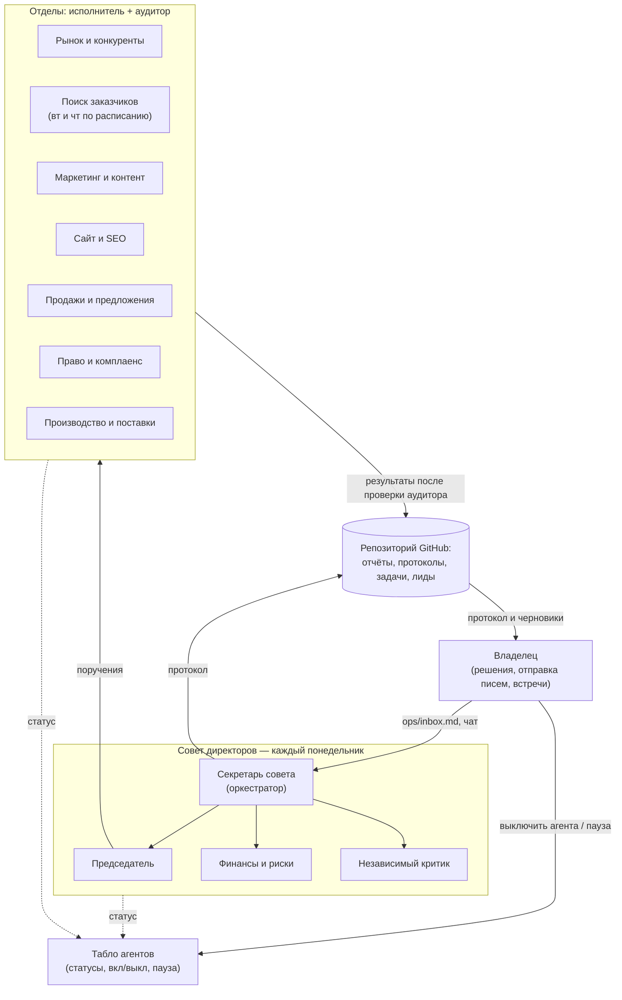

# Архитектура мультиагентной системы COLLIMA

## Схема

**Всего 18 агентов:**
- **Совет директоров (4):** председатель, финансы и риски, независимый критик, секретарь.
- **Отделы (7 × 2):** в каждом исполнитель и аудитор. Аудитор ставит исполнителю задачу с критериями приёмки и проверяет результат.

Роли, модели и инструкции — в `.claude/agents/*.md`, реестр — в `agents/registry.json`.

## Как это работает технически

| Часть | На чём сделано |
|---|---|
| Где работают агенты | **Облачные сессии Claude Code** на серверах Anthropic. Ваш компьютер не нужен: всё работает, даже когда он выключен |
| Когда запускаются | **Задачи по расписанию** в облаке: совет — пн 08:52, поиск заказчиков — вт и чт 09:52 (Минск) |
| Память | **Этот репозиторий:** отчёты, протоколы, доска задач, воронка лидов. Каждый запуск начинается с чтения и заканчивается коммитом |
| Команды агентов | Подагенты Claude Code из `.claude/agents/`. Секретарь совета вызывает их по процедурам из `ops/procedures/` |
| Пульт управления | **Табло** (артефакт claude.ai с базой данных): статусы, «кто чем занят», выключатели агентов, пауза всей системы |
| Связь с вами | `ops/inbox.md` (поручения совету), этот чат, протоколы совета, итоговое сообщение каждого запуска |

### Цикл недели
1. **Пн 08:52 — совет.** Секретарь собирает итоги и ваши сообщения. Аудиторы отчитываются. Председатель предлагает приоритеты, финансы и критик проверяют, председатель решает. Затем каждый отдел выполняет одну задачу с проверкой аудитора. Протокол — в `ops/board/`.
2. **Вт и чт 09:52 — поиск заказчиков.** Охотник ищет 10–15 компаний с сигналом потребности, аудитор проверяет (в том числе по санкционным спискам) и вносит принятых в `ops/leads/leads.md`.
3. **Вы**: читаете протокол, отвечаете на вопросы в `ops/inbox.md` или в чате, отправляете письма по черновикам, ведёте встречи.

## Управление

| Что хочу | Как |
|---|---|
| Выключить агента | Переключатель на табло. Выключенный агент пропускает свои задачи со следующего запуска |
| Остановить всё | Кнопка «Пауза для всех» на табло |
| Дать поручение | Записать в `ops/inbox.md` или написать в чате: «передай совету…» |
| Изменить расписание или частоту | Попросить в чате, например: «поиск заказчиков — каждый день» |
| Добавить или изменить агента | Попросить в чате, правка `.claude/agents/` |
| Запустить внеочередной совет | Попросить в чате: «проведи совет сейчас» |

## Модели и расходы

- **Совет директоров** — Opus 5.5. Можно перевести на **Fable** (сильнее в стратегии):
  - на тарифах **Max и Ultra** Fable входит в подписку (до 50 % недельного лимита);
  - на **Pro** оплачивается отдельно через usage credits по ценам API.
  
  Подробности — в справке Anthropic «Claude Fable models on your plan».
- **Отделы и аудиторы** — Sonnet 5.5: заметно экономнее, качества для исследований и черновиков достаточно.
- **Расходы:** запуски идут в счёт лимитов вашей подписки Claude. Совет с рабочим циклом всех отделов — самый тяжёлый запуск недели. Как экономить:
  - выключить на табло отделы, которые сейчас не нужны;
  - реже запускать поиск;
  - отделы на Haiku для простых задач.

## Чего система не делает (сознательно)
- Не отправляет письма, не публикует, не регистрируется, не платит. Только черновики, действия — за человеком.
- Не берёт военные и санкционные проекты и не предлагает обходных схем.
- Не заменяет юриста, бухгалтера и живые продажи: она готовит материалы, решения принимаете вы.

## Развитие (по мере надобности)
1. **Telegram.** Бот, которому можно писать поручения и который присылает итоги запусков. Варианты:
   - небольшой сервер с ботом + Claude Agent SDK (основа — `agent.py` в корне репозитория);
   - Claude Managed Agents.
   
   Оба варианта требуют API-ключа Anthropic, а он оплачивается по токенам отдельно от подписки. Сделаем, когда скажете.
2. **CRM** (Bitrix24 или HubSpot) вместо таблицы лидов, когда лидов станет больше 100.
3. **Подключения:** Gmail (черновики писем прямо в почте), Google Календарь, SEO-сервисы (Ahrefs, Semrush), когда сайт будет в сети.
4. **Метрики сайта** (Search Console, Метрика) — в протоколы совета.
